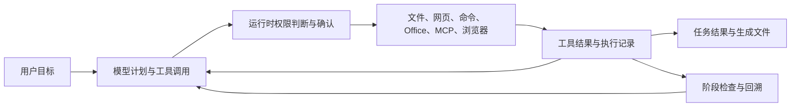

# ClearAct 项目完整改进记录

记录日期：2026-10-13；更新日期：2026-10-18。

历史基线：仓库可见初始版本至 **v0.2.0**，共 16 个提交，时间为 **2026-09-07—2026-10-13**。基线提交为 [`ce09958`](https://github.com/siesta3096/clearact-agent-plus/commit/ce09958bce69c782df3e28719b21f763a4bfca65)，版本快照为 [v0.2.0](https://github.com/siesta3096/clearact-agent-plus/tree/v0.2.0)。本文追加记录 **v0.2.1（2026-10-16）** 的产物验收与完成状态改进，以及 **v0.2.2（2026-10-18）** 的本地模型消息兼容修复。初始提交之前的开发过程不在这份可核实记录内。

这份文档用于回顾做过的工作、理解改进原因，并为后续维护保留入口。记录依据是提交历史、当前实现和测试；不会将固定模型测试换算为真实模型成功率，也不会将功能实现当作外部用户使用记录。

最新追加：**v0.2.3（2026-10-18）** 修复反馈留空时阶段重跑按钮无响应的问题，补充真实浏览器交互验证；详见 [重跑按钮修复记录](maintenance-2026-10-18-restart.md)。

**v0.2.4（2026-10-18）** 继续修复长生成响应超过固定 90 秒等待后被重发的问题：等待按模型可配置，读取超时不自动重发，并展示等待状态。详见 [等待超时修复记录](maintenance-2026-10-18-timeout.md)。

## 一、项目现在是什么

**v0.3.0（2026-10-18）**：增加执行导向的开发模式、搜索与精确编辑、静态检查、真实本地浏览器交互、
独立交付核对、依据真实记录生成的最终清单、文件 ZIP 和历史交付。
修复旧计划后续执行只贴代码却标记完成的问题。详见 [开发架构、失败分析与验证记录](development-agent-2026-10-18.md)。

ClearAct 是一个本地优先、可审查的 Agent 执行系统。模型提出计划和工具调用；运行时负责权限判断、确认、执行、超时、记录和文件恢复。用户可以查看阶段、工具结果、读取资料和文件修改，并从某个阶段提出反馈后重新执行。

当前主要能力包括：

- 接入 OpenAI-compatible API 和本地 Ollama。
- 读取本地文本、PDF、上传附件和图片；搜索网页并提取正文。
- 创建和修改文本文件，生成原生 Word、Excel 文件。
- 经用户逐次确认执行本机命令，记录输出、错误、退出码和超时。
- 接入本地或远程 MCP 工具，使用隔离的共享浏览器。
- 生成、展示和修订任务计划，限制重复读取和搜索。
- 保存任务历史、事件、检查点与写前快照，支持阶段回溯和旧分支查看。
- 在网关重启后核对遗留任务状态，保护已完成结果，并提示核查后继续。
- 按计划中的可选条件核对本轮产物、工具成功和已打开来源，保存逐项验收结果，未满足时以“需核对”结束。



## 二、迭代时间线

日期按真实 Git 提交记录整理。README 中的开发日期与提交归档日期可能不同，不据此增加独立发布次数。

| 时间 | 提交 | 主要工作 |
| --- | --- | --- |
| 09-07 | `9365864` | 建立 Agent 执行循环、双模型接口、文件/网页/MCP 工具、风险与审批、运行记录、检查点、快照、CLI 和基础 Web 控制台。 |
| 09-07 | `61991ad`、`7ed2c66` | 修正安装文档路径和仓库名称，减少照着文档安装时的歧义。 |
| 09-08 | `be37b5f`、`20b0b83` | 完善密钥表单与空值保持；加固配置和运行记录；补充环境诊断、示例配置、CI、导入校验及活动任务保护。 |
| 09-09 | `363d9df`、`4458d00` | 修复设置保存和显示，使快捷操作真正执行对应操作或进入工作区选择。 |
| 09-12 | `4104c8b`、`f1e3aa1` | Web 审批、单次运行配置与预算、上下文压缩、模型重试、工作流计划、按能力划分权限、MCP 超时隔离和并发初始化、失败和停止处理。 |
| 09-12 | `54a0459`、`227da90`、`baf9674` | 附件和图片输入、Provider 消息格式、PDF 工具、重复只读循环保护、玻璃界面；修正 CI 的枚举风格检查。 |
| 09-26 | `0ccb720` | 大文件/PDF 续读、文件版本与区间判断、截断答复续写、工作目录浏览、续接参数保留、ETag 更新和前端异步状态修复。 |
| 09-27 | `edeea5a` | 本地资料优先与任务资料策略、搜索预算和结果复用、文件差异预览、主题和壁纸设置。 |
| 10-04 | `dff6a57` | 动态修订后续计划、完成条件与有界核对、安全回溯预览、保护用户修改、旧分支档案、保留资料版本检查、共享浏览器和 MCP Registry。 |
| 10-13 | `ce09958` / `v0.2.0` | 修复浏览器动作、禁网识别和约束丢失；加入命令及 Word/Excel 生成、二进制快照与下载、生成期间冲突检测、重启状态对账、数据目录系统锁和固定执行场景。 |

10-16 的 v0.2.1 加入本轮产物验收与 `needs_review` 状态；10-18 的 v0.2.2 修复实际本地模型在计划后因系统消息位置不兼容而失败的问题。后续验证分别记在对应维护文档中。

## 三、模型接入与执行循环

### 3.1 统一两种模型接口

通过 Provider 层对接 OpenAI-compatible 和 Ollama 原生接口，统一返回正文、工具调用和用量信息，让后续权限与执行流程共用同一套运行时。

补充附件格式适配：文本和 PDF 提供工作区路径供工具读取；图片按对应接口的多模态消息结构发送。是否能理解图片仍取决于模型能力。

对接口明确返回的 reasoning 信息保留记录，兼容部分需要在工具轮次中回传该字段的接口；严格接口拒绝扩展字段时可回退请求格式。没有尝试还原模型隐藏的思维过程。

证据：[Provider 实现](../src/clearact/providers/)、[Ollama 格式测试](../tests/integration/test_ollama_provider.py)、[reasoning 测试](../tests/integration/test_reasoning.py)、[附件测试](../tests/unit/test_attachments.py)。

### 3.2 处理模型连接异常

区分临时网络故障、限流或服务异常与认证、配置等确定性错误。临时故障有界重试，保留已经完成的工具结果，并在界面显示连接恢复状态；认证失败给出明确错误，避免无意义重试。

模型答复因长度被截断时可以有界续写。空答复、异常请求和不支持工具调用等情况有更明确的处理，减少用户只能看到任务停住的情况。

证据：[模型错误分类](../src/clearact/runtime/model_retry.py)、[执行循环及异常测试](../tests/integration/test_runner.py)。

### 3.3 统一执行预算和超时

增加单次任务的迭代次数、工具调用次数和超时配置，并让 Web 单次覆盖参数实际生效。默认是 80 次迭代、240 次工具调用、60 秒单工具超时。

重复读取等复用操作不消耗实际执行预算。预算用尽时为尚未执行的调用补结果，保持记录完整。

证据：[运行设置](../src/clearact/settings.py)、[执行器](../src/clearact/runtime/executor.py)、[预算与取消测试](../tests/integration/test_runner.py)。

### 3.4 实际本地模型的消息模板兼容

`v0.2.2` 修复用户实际任务在规划后返回 HTTP 400 的问题：后续系统提示原本被放在对话末尾，而当前模型模板只允许开头系统提示。两个 Provider 在发送前合并系统角色提示，保留用户/工具顺序、调用关联和原始记录。工具结果不会被提升为系统提示。

原失败请求重放从 HTTP 400 转为 HTTP 200。实际本地模型在临时目录创建正确内容的文件，明确下一阶段提示后可达到 `completed`；这不等于已验证完整游戏生成。详细复现、单次验证与边界见 [10-18 修复记录](maintenance-2026-10-18.md)。

## 四、任务规划和完成状态

### 4.1 从工具流水变成可检查的任务阶段

增加任务开始时的具体计划，并在阶段真正开始时展示卡片。每个阶段有标题、说明、类型和完成条件，用户能查看该阶段实际执行的动作。

无效计划会被要求修正；重复无效计划会明确失败。简单问候可以直接答复，不必强行创建执行流程。阶段标题、标识和实际消息边界经过校验，减少重复阶段和不明确的回溯位置。

### 4.2 根据新证据修订后续计划

新增后续计划修订工具。保留已经执行和正在执行的阶段，替换后面的步骤，并记录原因、变化和次数。没有新进展时限制反复改计划；初始规划完成后移除不再需要的初始规划工具，减少输入负担。

### 4.3 让失败、未完成和已完成更接近实际

完成前核查阶段和已写文件；发现缺失或变化时给一次有界补做机会。全部动作失败或被阻止的阶段标为“需核对”，历史话题也能呈现核对提示。

`v0.2.0` 的 `done_when` 主要是文本条件，整体任务可能以 `completed` 结束并保留警告。`v0.2.1` 增加可选的 `checks` 条件：本轮生成文件、工具成功次数和不同已打开网页数量；验收依据真实结果，失败时保留 `needs_review` 任务状态，Web 与 CLI 明示。预算允许时给一次补做机会，补做成功后清除警告。仅有失败/拒绝记录不会额外触发补做请求。

需要保留的边界：模型不一定声明全部条件；这不是通用语义评分，文件核心结构通过不等于内容、排版和公式结果完整正确。详细规则与复现案例见 [2026-10-16 维护记录](maintenance-2026-10-16.md)。

证据：[工作流工具](../src/clearact/tools/workflow.py)、[规划集成测试](../tests/integration/test_workflow_plan.py)、[前端状态测试](../tests/unit/test_web_assets.py)。

## 五、文件处理、资料策略和重复操作治理

### 5.1 文件处理更完整

- 相对路径统一以本次工作目录为根，支持用户选择已有目录。
- 大文本按字符偏移分块读取；PDF 支持按页、页内位置续读，避免只读到开头就当作完整材料。
- 限制单次读取大小，对大文件给续读位置。
- 记录读取时的文件版本，检测读取前后源文件变化。
- 上传附件复制到当前工作区并记录；校验附件路径、数量和大小。

边界：PDF 目前提取文字，没有扫描件 OCR；图片能力依赖模型；原生 Office 生成不等于能够保真读取任意 Office 文件。

证据：[文件工具](../src/clearact/tools/filesystem.py)、[文件读取测试](../tests/unit/test_filesystem.py)、[附件与工作区测试](../tests/unit/test_web_recovery.py)。

### 5.2 从“读过就跳过”改成有效内容复用

相同文件、相同版本、相同或已覆盖的读取区间才可复用。文件改变后重新读取，超过文件末尾的区间不会被当作已覆盖。

复用时向模型提供此前的实际结果，而不只提示“已跳过”；同时避免把已经存在于模型输入的内容重复加入。跨后续对话或回溯复用，只使用仍然有效的保留资料，且不能绕过当前权限。

对同样失败的文件读取、同轮失败的 URL 和失效搜索服务减少重复尝试；连续无进展时停止无效循环。

证据：[执行循环](../src/clearact/runtime/runner.py)、[范围、版本、缓存权限及失败复用测试](../tests/integration/test_runner.py)。

### 5.3 按任务选择资料来源

增加仅本地、本地优先、混合、调查和平衡策略。附件和文件夹任务先读用户材料；联网调查有连续搜索和总量限制，搜索后要求打开来源。

近似查询可以复用，但年份变化不会简单当作重复查询。界面区分成功搜索和失败尝试，并显示资料策略、用时及工具次数。

`v0.2.0` 修复“别联网”“不要浏览网页”“do not use the internet”等表达的漏判。中途提出的禁网要求可以在泛化的“继续”之后保留；明确的新联网要求可以改变资料策略。引用、代码和条件分支单独处理，避免直接当作授权指令。

意图识别仍是确定性启发式，独立的权限判断继续承担授权控制。

证据：[资料策略](../src/clearact/runtime/research_strategy.py)、[策略案例](../tests/unit/test_research_strategy.py)。

### 5.4 网页读取与网络校验

搜索和正文读取提供回退途径；识别部分错误页面，避免将“页面不存在”当作正文成功结果。网页与 MCP 返回作为不可信资料处理。

网络读取采用地址校验和连接级地址固定，取消全进程 DNS 修改，并避免通过环境代理绕过已校验的地址。是否允许访问本机地址由配置决定。

证据：[网络实现](../src/clearact/tools/network.py)、[网页工具与测试](../tests/unit/test_web.py)。当前外部服务实际可用率没有由本次本地测试证明。

## 六、上下文管理

预算统计消息、工具定义、参数、接口返回的 reasoning 和附件引用。按完整的助手工具调用及全部结果组成事务，避免压缩后出现孤立结果或未闭合调用。

旧工具内容不会被提升成系统指令。必要内容超出预算时明确报错，让用户增加上下文或减少输入，而不伪造压缩摘要。

历史阶段的工具选择调整为保留跨阶段能力，避免读完资料后需要写文件时工具已经不可用。

`v0.2.0` 将所有用户请求列为必要内容，修复压缩遗失中途“不要覆盖已有文件”等要求的问题。代价是长会话所需预算增加；目前没有用模型摘要来替代原始要求。

预算采用 UTF-8 字节数作为保守估计，尚未使用各模型真实 tokenizer。

证据：[上下文实现](../src/clearact/context/)、[事务、预算和用户要求保留测试](../tests/unit/test_context_budget.py)。

## 七、权限、确认、密钥和界面输入保护

### 7.1 权限由颜色阈值扩展为能力规则

本地读取、联网读取、浏览器交互、工作区创建/修改、MCP 只读/外部修改、工作区外写入、高影响行为分别配置自动允许、先询问或关闭；保留旧颜色阈值兼容。

Web 任务使用实际配置的权限与单次设置，不再只展示选择却按另一个等级执行。审批暂停当前动作，确认时校验动作标识；拒绝也返回模型并记录。

高影响操作保持强制确认。低授权级别不能读取、列出或写入授权工作区以外的位置；普通外部路径写入依既有政策处理，工具仍校验受保护路径。

证据：[政策](../src/clearact/runtime/policy.py)、[风险评估](../src/clearact/runtime/risk.py)、[权限测试](../tests/unit/test_policy.py)、[风险测试](../tests/unit/test_risk.py)。

### 7.2 密钥与配置处理

增加配置模板和环境变量形式；环境变量优先，减少真实密钥进入仓库的需要。设置 API 不回显密钥，表单空值不会误清空既有密钥。

MCP 的 env/headers 只保留在本机配置，接口只展示必要的键名或脱敏信息。导入限制服务数量、名称、参数和凭证字段体积。

默认工作区定位于仓库的业务目录；配置收敛到单个用户 JSON，提供环境诊断入口。配置写入和任务 JSON 保存使用临时文件替换，降低半写入风险。

证据：[设置](../src/clearact/settings.py)、[Web 设置接口](../src/clearact/webapp.py)、[设置与导入测试](../tests/unit/test_webapp.py)。

### 7.3 前端处理不可信输入

修复动态内容进入 HTML 属性的风险，校验可点击 URL 协议；对阶段说明、计划修订原因、文件名和工具记录进行转义。浏览器记录会隐藏 URL 中的部分敏感参数。

证据：[前端](../src/clearact/web/app.js)、[前端输入保护测试](../tests/unit/test_web_assets.py)、[浏览器测试](../tests/unit/test_computer_use.py)。这些措施不等于对所有网页和模型输入提供完整安全保证。

## 八、持久化、失败记录、阶段回溯和重启

### 8.1 运行记录更接近实际执行

任务、事件、消息、阶段和成功动作检查点落盘。拒绝、跳过、工具异常、`ok=false`、取消和预算耗尽均保留对应结果；失败不写成功检查点。

停止时先等待清理，再读取最新记录，避免覆盖刚保存的进展。初始化失败能写入失败状态和错误说明。禁止删除或重复启动仍在运行的任务；手动标题在后续执行中保留。

话题续接保存原工作目录、模型、预算和语言；旧记录从授权信息迁移，目录缺失时明确拒绝，避免悄悄在新目录执行。

证据：[RunStore](../src/clearact/storage/run_store.py)、[执行集成测试](../tests/integration/test_runner.py)、[Web 恢复测试](../tests/unit/test_web_recovery.py)。

### 8.2 从阶段带反馈重新执行

回溯有稳定的消息边界；保留前面的阶段和结果，归档完整旧分支及事件，再把反馈带入新执行。可查看此前的分支，而不丢弃原始过程。

确认前展示哪些阶段保留、哪些重做、哪些文件可恢复和有哪些外部影响。预览结果与确认绑定，预览后文件变化会要求重新核对。

倒序恢复写入前快照，核对快照目标与真实动作路径；只有当前内容仍等于 Agent 上次写入，才进行恢复。用户后来改过的文件保持不变。

保留阶段读取的资料如果变化，或旧记录缺少版本信息，会提示重新读取。文件预览使用对应动作当时的记录和快照，而不冒充实时内容。

证据：[阶段回溯测试](../tests/unit/test_web_recovery.py)、[恢复和预览测试](../tests/unit/test_webapp.py)。

### 8.3 重启后的遗留任务状态对账

`v0.2.0` 增加 `interrupted` 状态和启动扫描。未结束任务保留已完成结果，补齐没有最终结果的工具调用，并让用户看到原审批已经失效。

补入工具结果会移动消息位置，因此同步修正阶段回溯索引。扫描不限于最近 20 个任务；损坏或标识不匹配的记录被跳过并记录，不阻塞其他任务。

运行时不自动重放未知结果的命令、文件写入、MCP 或浏览器操作，提示用户核查可能已经发生的影响后再继续。前端显示中断提示；没有计划的中断任务不再无限显示规划动画。

生命周期改为 FastAPI lifespan，关闭时清理浏览器，移除原来的弃用写法。

证据：[恢复测试](../tests/unit/test_web_recovery.py)、[恢复与产物边界测试](../tests/unit/test_recovery_artifact_integration.py)、[中断界面测试](../tests/unit/test_new_web_ui.py)。这仍不等于崩溃后自动精确续跑或 exactly-once 执行。

### 8.4 数据目录的跨进程写入协调

网关在对账之前取得系统文件锁并持有到关闭；CLI 执行和快照恢复取得同一把锁。另一个进程占用时立即拒绝，避免误将其活动任务标为中断，以及并发写同一份账本。

同进程的多个任务和网关内部 CLI 调用可重入共用锁，以引用计数保证最后一个使用者退出才释放。进程崩溃由系统释放锁；只读历史和检查不受此限制。

Windows 使用 `msvcrt.locking`，POSIX 使用 `flock`。Windows 通过真实子进程验证，POSIX 的实测以 Linux CI 后续记录为准。

证据：[数据目录锁](../src/clearact/storage/lease.py)、[跨进程测试](../tests/unit/test_data_lease.py)。

## 九、MCP 和共享浏览器

### 9.1 MCP 接入和故障隔离

支持 stdio 和 Streamable HTTP，发现远端工具并加服务命名空间，避免重名。每个服务独立持有连接，并发初始化；连接超时或失败只跳过对应服务，不阻塞整个任务。

MCP 工具走同一套执行、风险、审批、超时和记录流程。只读和破坏性注解进入风险判断；未知副作用按外部修改处理。

设置支持手工配置、常见 `mcpServers` JSON 导入、连接测试和 Registry 搜索。Registry 仅用于发现，不能替代发布者和权限核查。

证据：[MCP 实现](../src/clearact/tools/mcp.py)、[超时与权限测试](../tests/unit/test_mcp.py)、[真实本地 echo 服务集成测试](../tests/integration/test_mcp_manager.py)。

### 9.2 共享隔离浏览器

用户主动打开浏览器侧栏后，可以查看、导航和人工控制同一个隔离页面；Agent 可以读取正文和元素、导航、点击和输入。浏览与交互采用不同权限。

密码字段不能由 Agent 填写，下载默认禁用；识别到的发送、删除、支付等高影响按钮保持明确确认。不是全桌面控制，也不会自动继承用户常用浏览器的登录状态。

`v0.2.0` 修复 `press/scroll/back/reload` 转发时重复传入 `action` 的错误，并测试实际会话方法和滚动限幅。浏览器 URL 校验与脱敏继续保留。

证据：[浏览器实现](../src/clearact/tools/computer_use.py)、[浏览器测试](../tests/unit/test_computer_use.py)。当前最多一个会话，关闭或重启后不自动恢复。

## 十、Web 控制台与使用体验

- 历史话题持久化，支持续聊、停止、重命名、删除和阶段反馈。
- 设置能够保存并回填模型、接口、预算和权限；空密钥字段保持既有值。
- 快捷操作可真正选择工作目录和接入能力。
- 工作区选择支持目录浏览、路径校验和目录查询超时提示。
- 展示本轮请求，旧请求可展开；结果卡片取最新请求的答复，避免展示上一轮结果。
- 前轮阶段和瞬时提示按当前请求区分，减少旧状态影响新执行。
- 修复切换话题、发送和异步响应之间的状态竞态。
- ETag 与定时更新避免每次重新解析完整历史；当前不是 token 流式输出。
- 阶段可查看实际动作、权限依据、错误、读取资料和写入差异；复用读取可打开原结果。
- 结果区的“已读取资料”只列成功打开的文件和网页，并说明不等于逐条结论引用。
- `v0.2.0` 加入生成文件下载、命令独立权限开关、友好的工具名称和中断提示。
- `v0.2.3` 修复阶段重跑留空无响应：反馈可选、先预览再确认、按钮旁显示进度和错误，并阻止重复提交。
- 外观支持阳光/黑暗模式、玻璃/森林/深空主题、主题深浅与玻璃染色、可调或关闭的动态效果和光标拖尾。
- 自定义壁纸保存于浏览器独立存储，避免大图片占满 localStorage，并迁移旧壁纸记录。

证据：[前端代码](../src/clearact/web/app.js)、[样式](../src/clearact/web/style.css)、[前端测试](../tests/unit/test_web_assets.py)、[新界面行为测试](../tests/unit/test_new_web_ui.py)。

## 十一、v0.2.0 新增的通用命令工具

工具名：`execute_command`。

| 改进 | 当前行为 |
| --- | --- |
| 输入和起始目录 | 接受可执行程序与参数数组，不隐式拼接 shell；起始目录必须位于当前工作区。 |
| 权限 | 每条命令单独确认；高自主等级与显式 allow 都不能绕过。关闭相关能力或明确离线时隐藏并拒绝命令。 |
| 输出 | 记录 stdout、stderr、退出码、超时和截断；默认每流保留 2000 字符，支持指定文本编码。 |
| 上下文 | 大量中英文日志被截断；使用所有内置工具定义和默认 32K 配置验证输入仍可容纳。 |
| 超时 | 请求与全局工具超时取较小值，留出清理余量；非法超时值不能被裁剪后意外执行。 |
| 停止 | Windows Job Object 管理普通子进程生命周期，POSIX 用独立会话/进程组；结束、超时、取消时清理。 |
| 失败记录 | 非零退出或超时是失败，不建立成功检查点；无法启动与未知副作用作区分。 |
| 回溯提示 | 命令的外部影响不能自动撤销，成功、失败或中断都按实际记录提示核查。 |

修复过程中还发现并处理了三个细节：父进程退出后子进程继续写文件、非文本 codec 通过验证后命令已经执行、隐藏控制台窗口后输出句柄未正确传递。

关键边界：命令使用本机用户权限并继承环境。工作目录和 Job Object 不提供文件或网络沙箱；不提供后台服务托管，POSIX 主动脱组进程不在清理保证内。

证据：[命令实现](../src/clearact/tools/command.py)、[Windows 工作进程](../src/clearact/tools/_command_worker.py)、[命令测试](../tests/unit/test_command.py)、[真实副作用与权限测试](../tests/unit/test_command_policy.py)、[输出预算测试](../tests/integration/test_command_context.py)。

## 十二、v0.2.0 新增的 Word 和 Excel 工具

### 12.1 原生 Word 文档

`create_document` 生成真实 `.docx`，支持 A4、中文字体、标题和副标题、分节标题、段落、列表、表格、跨页重复表头和页码。模型提交结构化内容，由工具生成文件，不将文本冒充 Office 二进制格式。

### 12.2 原生 Excel 工作簿

`create_spreadsheet` 生成真实 `.xlsx`，支持多工作表、原生表格样式、筛选、冻结首行、列宽、数字/日期格式、ISO 日期输入、原生公式和柱状/折线图。

公式设置为打开时重新计算，返回中标明本地未计算公式。纯文本列将看似公式的字符串保留为文本；非法数据和过大输入先拒绝，避免留下半成品。

### 12.3 原生文件的安全保存与恢复

- 加入二进制写前快照，保留旧文本快照兼容。
- 内存生成和落盘分开；线程仅生成字节，最终保存同步提交，避免取消后后台写文件。
- 同目录临时文件替换，保存内容哈希。
- 渲染前捕获存在状态、文件版本和内容指纹；提交前重新解析路径并核对，用户创建或修改同名文件时拒绝覆盖。
- 对相同长度、修改时间被恢复但内容改变的文件，仍可通过指纹检测。
- 产物和被覆盖的旧文件限制为 32 MB。
- 完成前文件核查包含 Office 产物；回溯按倒序核对生成内容并还原原始字节，保护用户后续修改。
- 下载核对任务、动作、成功状态、路径、工作区和内容哈希；文件缺失、改变或与记录不符时拒绝返回。
- 文件已经生效但崩溃前没有记录最终结果时，重启与回溯提示核查残留影响。

这些工具目前负责结构化新文件生成，不负责任意复杂旧文件的保真编辑。生成后可重新读取内容和格式属性；尚未把 Office GUI 或逐页视觉验收记为已完成。保存前检查也不等于与任意外部编辑器共享的原子比较替换。

证据：[Office 生成](../src/clearact/tools/office.py)、[产物提交](../src/clearact/tools/artifacts.py)、[快照](../src/clearact/storage/snapshots.py)、[生成与取消测试](../tests/unit/test_office.py)、[下载与回溯测试](../tests/unit/test_artifact_web.py)、[崩溃和并发修改测试](../tests/unit/test_recovery_artifact_integration.py)。

## 十三、验证和可持续维护的证据

### 13.1 v0.2.0 已完成的本地验证

| 项目 | 记录 |
| --- | --- |
| 修改前审查基线 | 203 项测试通过，存在 2 条 FastAPI 生命周期弃用警告。 |
| v0.2.0 完整测试 | 348 项测试通过，耗时 18.69 秒；没有此前的弃用警告。 |
| 本轮新增验证 | 增加 145 项参数化与场景测试，覆盖权限、子进程、文件格式、取消、冲突、回溯、重启和锁。 |
| 代码检查 | Ruff 通过。 |
| 前端检查 | JavaScript 语法和 Node 行为测试通过；差异检查通过。 |
| 真实浏览器 | 在隔离配置/工作区启动本地网关，用 Edge 验证两个文件下载、命令权限、中断提示和无无限规划动画；没有页面脚本错误。 |
| 本地协议集成 | 启动测试 MCP echo 服务，验证工具发现与调用。 |
| 仓库版本 | 代码、测试和维护说明已上传 main；v0.2.0 标签指向 ce09958。 |

该版本新增依赖为 `python-docx` 和 `openpyxl`，版本统一为 0.2.0；后续 0.2.1 没有增加依赖。已有 CI 会安装开发依赖并运行检查与测试；本地通过不等于已经检查过远端 CI 结果。

### 13.1.1 v0.2.1 验收维护验证

本轮在 348 项基线上增加 40 项验证，完整测试 **388 项通过**；Ruff、JavaScript 语法与差异检查通过。真实 Edge 在临时配置/工作区中验证验收未通过、补做原生 Word 后通过、中英文及明暗主题，没有页面脚本错误。

固定模型响应覆盖缺失产物、伪装 Office、失败/拒绝命令、重复来源、读取权限、旧记录和多轮隔离；界面/API 验证逐项显示、转义、终态无无限动画，以及续聊清空旧报告。详细入口见 [验收维护记录](maintenance-2026-10-16.md) 和 [完整场景测试](../tests/integration/test_completion_acceptance.py)。这不是付费模型评测或外部用户数据。

### 13.1.2 v0.2.2 实际故障回归

新增 6 项消息模板与错误诊断回归后，完整测试 **394 项通过**，代码、JavaScript 语法与差异检查通过。实际本地服务的原失败请求从 HTTP 400 转为 HTTP 200；隔离临时目录中的文本生成小任务完成规划、阶段声明、写入与答复，状态为 `completed`。这是一项真实模型单次验证，未验证完整游戏玩法。详见 [10-18 修复记录](maintenance-2026-10-18.md)。

### 13.1.3 v0.2.3 重跑交互回归

新增 6 项交互与回溯验证后，完整测试 **400 项通过**，代码、JavaScript 语法与差异检查通过。真实 Edge 在刷新后的失败任务中验证留空预览、取消不执行、预览失败就地提示，以及确认后仅提交一次并保留原目标。模型执行用固定回调替代，未操作真实任务。详见 [重跑修复记录](maintenance-2026-10-18-restart.md)。

### 13.1.4 v0.2.4 长等待回归

新增 18 项回归后，完整测试 **418 项通过**，代码、JavaScript 语法与差异检查通过。真实本地 HTTP 服务延迟 95 秒返回完整响应，实际 Provider 在 95.27 秒后成功接收，只有 1 次请求；真实 Edge 验证等待提示、保存/重读模型等待设置和失败状态。该延迟验证不调用模型，专门覆盖先前短任务测试未覆盖的传输等待问题。

### 13.2 固定的完整执行场景

[固定场景测试](../tests/integration/test_task_scenarios.py) 使用真实运行时、工具、权限、存储和快照，模型响应固定：

1. 读取本地资料，生成真实 Word 和带 SUM 公式的 Excel，核对产物、审计和检查点。
2. 拒绝命令，确认没有文件副作用，拒绝进入记录。
3. 允许命令，确认输出和退出码。
4. 命令非零退出，确认失败记录和没有成功检查点。

这些场景提供稳定的回归基线，可以在修改后反复检查。它们不调用付费模型，不证明真实模型理解、规划或完成任意任务的成功率。

### 13.3 验证入口

```powershell
$env:PYTHONPATH = "$PWD/src"
python -m pytest -q -p no:cacheprovider
python -m ruff check src tests --no-cache
node --check src/clearact/web/app.js
```

单独回归完整场景：

```powershell
python -m pytest tests/integration/test_task_scenarios.py -q -p no:cacheprovider
```

缓存关闭参数用于避免当前环境的缓存目录访问问题，不改变测试目标。

## 十四、回顾时最值得讲清楚的工程案例

| 案例 | 当时的问题 | 采取的办法 | 可以证明的结果 |
| --- | --- | --- | --- |
| 大文件续读 | 截断内容容易被当作完整材料 | 字符偏移、PDF 页/页内续读和版本记录 | 可以读取后续内容，并检测源变化。 |
| 结果复用 | 反复读取/搜索浪费调用；直接跳过又丢证据 | 按版本与范围复用实际结果，保留权限检查 | 复用内容仍进入模型输入，变化后重新读取。 |
| 安全回溯 | 恢复旧快照可能覆盖用户后来的修改 | 路径/内容检查、影响预览和完整旧分支 | 用户改动保留，旧执行过程可查看。 |
| 长会话约束 | 中途要求可能被压缩移出 | 所有用户请求必要保留，超预算明确失败 | 已复现的禁止覆盖要求不再静默丢失。 |
| 命令生命周期 | 超时或父进程退出后孩子仍继续写 | Job Object/进程组、预算统一和副作用测试 | 普通子进程停止后不再延迟写入。 |
| 文档并发修改 | 渲染耗时期间用户改了目标文件 | 前后版本/指纹检查与重新解析路径 | 拒绝覆盖用户新内容，错误前不建立快照。 |
| 重启与并发进程 | 遗留状态不真实，另一个进程可能还在执行 | 中断对账、协议修复和系统数据锁 | 保留已完成结果，不误处理其他进程的活动任务。 |

介绍项目时应结合自己的设计、调试、取舍和验证贡献说明 AI 辅助范围。提交、测试和文档提供事实入口，不能代替对实现的理解。

## 十五、后续仍需维护的范围

- v0.3.0 已加入一项真实模型开发任务的两轮评估和固定产物回归；继续扩大任务集，记录配置、用时、工具次数、人工干预和失败案例。
- 在 v0.2.1 的三类验收基础上验证真实模型能否完整提取要求，补充内容质量验收与人工核对记录；不把可选条件通过当作任意任务的正确性保证。
- 继续做崩溃注入、回溯事务日志和外部副作用对账；检查点目前主要是成功凭证，不是自动重放引擎。
- 验证 POSIX 进程清理与系统锁、更多 Provider/MCP 服务及普通安装包的配置定位。
- MCP OAuth/DCR、旧 SSE、resources/prompts/sampling、跨运行连接池尚未实现。
- 模型 token 流式输出、浏览器会话跨重启保留、扫描 PDF OCR，以及复杂 Office 文件读取/保真编辑尚未实现。
- 没有已经核实的外部活跃用户数、长期使用率或真实模型成功率，不补造这些指标。

后续每一轮可以按“复现场景 → 原因与取舍 → 修改 → 验证 → 提交/版本”的顺序补入这份记录，逐渐积累可以核实的维护过程。

## 相关文档

- [v0.3.0 开发模式：架构、工具、真实项目与回归记录](development-agent-2026-10-18.md)
- [真实模型开发样例及两次评估](../examples/README.md)
- [使用说明](../README.md)
- [变更日志](../CHANGELOG.md)
- [修改前项目审查](project-review-2026-10-13.md)
- [v0.2.0 维护说明与工具输入示例](maintenance-2026-10-13.md)
- [v0.2.1 产物验收维护记录](maintenance-2026-10-16.md)
- [v0.2.2 本地模型消息兼容修复](maintenance-2026-10-18.md)
- [v0.2.3 阶段重跑交互修复](maintenance-2026-10-18-restart.md)
- [v0.2.4 长生成等待与重试修复](maintenance-2026-10-18-timeout.md)
