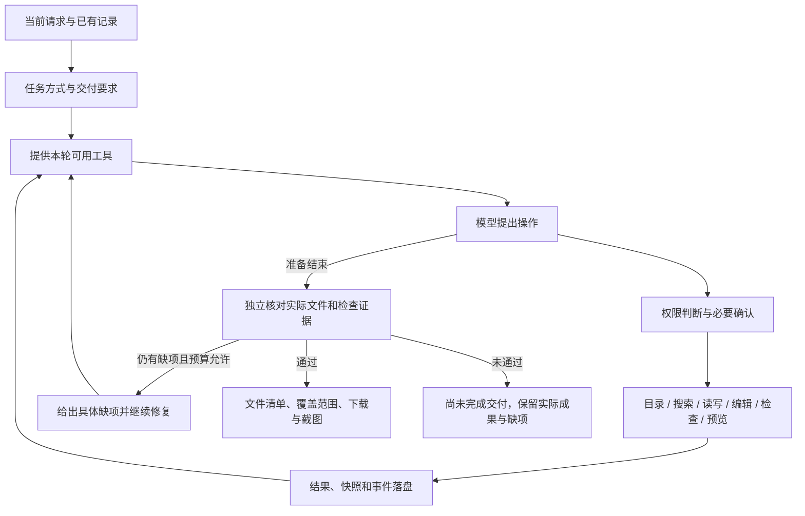

# v0.3.0：从代码答复转向项目交付

本文记录 v0.3.0 的历史设计与验证。v0.3.2 已将文件数量、架构文档和新网页交互改为按需求选择，当前规则见 [轻量化维护记录](maintenance-2026-10-20-lightweight.md)。

## 这次解决的问题

真实失败对话的目标是在空文件夹实现视觉小说游戏。用户随后再次要求“去实现一下”。
旧运行只执行了计划工具，最后把约两万字符的 HTML 贴在答复里，让用户自行保存。
所选工作目录没有游戏文件，任务却被标记为完成。

原因有两层：初始请求只给计划工具，旧答复又把这个暂时状态描述成整个会话没有文件能力；
复用已有计划的后续请求没有重新审查尚未进入的阶段。原有验收项还是模型可选声明，
不足以约束“开发项目”必须实际交付。此次改动没有修改那段用户记录，也没有伪造成功状态。

## 执行结构



| 部分 | 代码位置 | 职责 |
| --- | --- | --- |
| 任务与交付数据 | `src/clearact/domain/models.py` | 保存任务方式、文件指纹、检查结果和先前交付记录；旧记录有默认值 |
| 交付核对 | `src/clearact/runtime/delivery.py` | 推断开发任务、生成执行约束，并依据本轮真实操作核对文件与检查 |
| 后续执行识别 | `src/clearact/runtime/continuation.py` | 显式继续未完成计划时重新纳入阶段验收；不授予工具权限 |
| 执行循环 | `src/clearact/runtime/runner.py` | 提供工具、处理确认和失败、有限修复、停止与诚实结束 |
| 开发工具 | `src/clearact/tools/development.py` | 代码搜索、唯一文本编辑、只读语法与引用检查 |
| 浏览器检查 | `src/clearact/tools/project_preview.py` | 临时本地静态服务、隔离浏览器、交互断言、错误与截图 |
| 文件写入 | `src/clearact/tools/filesystem.py` / `artifacts.py` | 覆盖前快照、版本冲突检查和原子替换；供回溯核对 |
| 控制台界面 | `src/clearact/web/app.js` / `webapp.py` | 任务方式、交付结果、文件预览、ZIP、截图和先前记录 |
| 真实模型评估 | `scripts/evaluate_development.py` | 使用配置的本地模型在独立空目录创建完整小项目，不在单元测试里调用模型 |

## 改变的行为

1. 开发任务从第一轮就可以使用文件工具，计划用于说明进度。无需用户在计划后再次催促实现。
2. 每轮提供给模型的实际工具名称写入 `model.waiting` 事件，可以核查“工具没有提供”还是“模型没有使用”。
3. 继续旧对话时，在请求视图中更新运行时自己生成的初始说明，并明确当前可用文件工具；原始消息账本保持原样。
   另外从工具记录建立有限大小的项目状态，保留真实路径与检查状态；上下文压缩后无需猜测先前的文件名。
4. 重新执行时依据真实保留的阶段和工具结果建立上下文，重试指令不代表之前已经设计或写过文件。
5. “开发与交付”要求先检查目录或代码、实际落盘、核对写入后的文件指纹，并在最后修改后成功检查。
6. 新项目要求至少两个非空源文件、非空 `README.md` 和 `ARCHITECTURE.md`（或 `docs/architecture.md`）。
   这是结构要求，不等于自动判断架构质量。
7. 新 HTML 项目还需要浏览器交互与预期文本断言。用户要求测试时，语法检查不能冒充测试。
8. 修改后需要重新检查；后续失败检查会使更早的成功记录不足以支持结束。
9. 模型准备过早结束时，运行时反馈具体缺项。没有新工具进展则不反复重试；开发模式最多三轮交付修复。
10. 仍然未通过时显示“本轮项目尚未完成交付”，列出真实文件和未满足的条件。
    被拦下的答复保留在 `rejected_responses`，不会作为已经完成的项目展示。
11. 错误或停止时保留已完成的文件操作并生成当前交付核对，方便继续维护。
12. 后续讨论会保留先前交付记录；ZIP 只包含对应轮次有成功写入证据且仍然匹配指纹的文件。
    用户后来修改文件时，旧下载会拒绝返回不再匹配的内容。
13. 已交付计划记录完成状态。下一轮只修改某个模块时，不会强迫重新写入原计划的全部文件；
    回归场景在创建并测试项目后，继续只修改一个入口文件，重新验证并保留上一轮交付记录。

## 工具的具体边界

- `search_files`：字面文本搜索，返回路径、行号和片段。跳过依赖目录、`.git`、`.env`、符号链接和二进制内容；
  最多检查 1000 个候选文件、返回 100 处匹配，每个文件至多 1 MB。
- `edit_file`：只替换一个唯一匹配的 UTF-8 文本片段，可提供预期 SHA-256。匹配歧义或版本变化会失败；
  修改前保存快照，保留原文件换行；不支持二进制和超过 32 MB 的文件。
- `check_files`：Python 语法、JSON 解析、HTML 本地脚本/样式引用存在性、Node `--check` 的 JavaScript 语法。
  不执行项目代码，不证明逻辑正确，暂不支持 TypeScript/CSS 的语法检查；明确返回覆盖范围。
- `preview_project`：使用本机 Chromium（Windows 使用 Edge）打开工作区 HTML，支持点击、填入、按键和预期文本。
  收集页面/控制台错误、HTTP 失败和被阻止的外部请求；截图保存于工作区 `.clearact/previews/`。
  HTTP 服务只读取工作区静态文件，外部 HTTP 请求与 WebSocket 被拦截，Service Worker 被禁用。
  返回可见控件及唯一选择器，失败后仍返回当前页面文字与已完成步骤。可指定断言区域，避免旧提示文字冒充当前结局。
  每次新建浏览器上下文；单次可通过“存档—重启—读档”等连续步骤检查同一上下文内的状态。
  不能代替后端服务测试、所有浏览器兼容性测试或视觉设计审查。
- `execute_command`：继续保留逐次确认和原有权限约束，不因开发模式而自动扩大权限。

## 使用方式

Web 输入框旁可选：

- **自动识别**：根据当前用户请求和之前的用户要求选择方式。识别是启发式，复杂表述可手动选择。
- **开发与交付**：创建、实现或维护实际项目，启用交付核对；明确只要求解释的后续问题仍按只读讨论处理。
- **讨论与分析**：提供只读工具，不执行写文件、通用命令或网页预览。未完成的旧计划不会强制转成实施。

CLI 示例：

```powershell
clearact run "在空目录创建一个可玩的视觉小说游戏，拆分模块并测试" --workdir E:\my-project --task-mode develop
```

本地真实模型评估（独立空输出目录，最长 20 分钟；生成与运行记录保留在输出目录）：

```powershell
$env:PYTHONPATH = "src"
python scripts/evaluate_development.py --output data/evals/my-development-eval
```

评估仅连接配置的 localhost 模型，关闭外部资料与 MCP，不执行通用命令；模型可使用原生文件、语法检查和浏览器检查。
它要求生成幽默中世纪视觉小说，覆盖两个结局和存档读档。评估摘要只包含模型名称、状态、工具记录与交付报告，
不导出 API Key 或配置。

## 验证结果

固定响应回归与实际模型运行分开记录。固定响应测试验证控制器是否正确处理证据，不能用来宣称模型稳定完成任务。

- 真实文件闭环：创建计算模块、入口、测试、运行说明和架构说明，先运行失败测试，再精确修改、语法检查与测试通过。
- 真实浏览器：加载分离的页面/引擎/剧情模块，分别点击两个分支并断言两个结局；实际生成 PNG。
- 失败浏览器：缺失脚本与外部请求均使检查失败，仍保存截图供审查。
- 负向回归：代码贴在聊天中、检查早于最后修改、测试未获批准、用户外部编辑、越界/伪造下载、旧计划讨论与重试。

真实模型使用用户配置的 localhost `qwen/qwen3.8-27b`，两轮都经生产执行循环在独立空目录运行，没有代写游戏代码。

| 实测 | 耗时 | 文件与验证 | 最终状态 |
| --- | --- | --- | --- |
| 第一次 | 510.72 秒 | 6 个文件，5 次浏览器检查成功；仍有声明的静态检查未通过、早期读取失败未归并 | `needs_review` |
| 第二次 | 865.56 秒 | 6 个文件；静态检查 2 次成功、1 次失败；浏览器 3 次成功、3 次失败；一次交付反馈后继续读取、修正路径并复检 | `completed` |

第一轮还暴露了模型最终说明把文件名、剧情与检查情况说错的问题，因此开发结果改为依据记录生成，
原模型答复放在最终消息 `metadata.model_draft` 供审查。第二轮暴露的错误选择器、隐藏按钮、错误路径和上下文遗忘，
推动了可见控件选择器、失败页面反馈、指定断言区域和持久项目状态等补强。
这是开发期间的两轮评估，代码在其间及其后继续修正，不能据此计算某个固定版本的一般成功率。

第二轮的源代码与文档按原始字节保存在 [`examples/cheese-case/`](../examples/cheese-case/)，
文件 SHA-256、两轮工具统计与原任务要求见 [脱敏评估记录](evaluations/2026-10-18-development.json)。
保存的第二轮运行已用最终交付核对重新审查，15 项检查通过。
另用独立浏览器回归遍历样例全部结局，检查保存、刷新页面、读档与重开；这与模型自己选择的两条流程分开记录。
发布检查记录见下方；单元/集成回归同时覆盖固定响应、真实文件、子进程、浏览器与保存的模型产物。

Web 界面通过真实 Edge 检查文件清单、ZIP 下载与截图访问；390 像素宽度下没有横向溢出。

发布检查（Windows / Python 3.12.9）：

- `python -m pytest -q -p no:cacheprovider`：**470 passed**，47.70 秒。
- `python -m ruff check src tests scripts`：通过。
- `node --check src/clearact/web/app.js`：通过。
- `python -m clearact.cli doctor`：通过；顺带修复未配置 `apiKeyEnv`、只使用本地 `apiKey` 时诊断命令崩溃的问题。
- 已暂存改动检查无空白错误；本地配置、API Key、真实用户对话和任务目录未纳入发布。

## 能力定位

这次升级的是实际开发所需的执行与交付机制。产物的实现质量、复杂问题的判断、长程任务的稳定性仍受所选模型影响。
自动核对证明文件与操作记录之间的关系，不能证明需求全覆盖或与 Codex 等成熟开发工具具有相同能力。
模型仍返回完整响应后才继续执行，尚未提供生成过程的逐字流式显示；本次本地模型耗时也说明响应速度仍有明显限制。
目前交付清单只收录原生文件工具写入的文件；通用命令自行产生的新文件不自动纳入清单或快照。
ZIP 下载是对应轮次的改动文件包，后续轮次的包可能需要应用到已有项目，不能一概当成整个工作区的完整备份。
